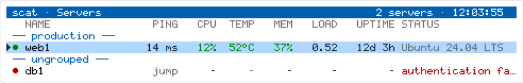

<p align="center">
  <picture>
    <source media="(prefers-color-scheme: dark)" srcset="docs/logo-dark.svg">
    
  </picture>
</p>

<p align="center">
  <b>Your servers, one terminal window.</b><br>
  See how busy they are, how hot they run and how full their disks are, then jump in with one key.
</p>

<p align="center">
  <a href="https://github.com/d3m0naz/scat/releases"></a>
  <a href="LICENSE"></a>
  <a href="#1-get-bash-5"></a>
</p>

<picture>
  <source media="(prefers-color-scheme: dark)" srcset="docs/screenshot-list.svg">
  
</picture>

scat is a small app for your terminal. It logs in to your servers with plain
SSH and shows you what they are doing. Nothing gets installed on the servers.
No agents, no web panel, no passwords stored.

## Why you might like it

- 👀 **One screen for all servers**, grouped the way you like.
- 📊 **Detail view** with CPU, memory, disks, network and the busiest processes.
- 🔑 **Keys only.** scat never asks for or stores a password.
- 🐚 **Just Bash.** No Python, no Node, no extra tools on your servers.
- 🎨 **Five colour themes**, including a high-contrast one.
- 🐳 **Docker, read only:** see your containers, nothing gets changed.
- 🌡️ **Temperatures and disk health**, if you want them. This needs one `sudo` rule (see below).

## Quick start

Takes about five minutes.

### 1. Get Bash 5

scat needs Bash 5 on the machine **you work on** (not on your servers).
Check your version with `bash --version`.

| Your system | What to do |
|---|---|
| macOS | `brew install bash`, then put `/opt/homebrew/bin` first in your `PATH` |
| Linux | Usually there already. Otherwise `apt install bash` (or `dnf` / `pacman`) |

The macOS system Bash (version 3.2) is too old and is not supported.

### 2. Install scat

```sh
curl -fsSL https://raw.githubusercontent.com/d3m0naz/scat/main/install.sh | bash
scat --help
```

The installer downloads the current release and checks its SHA-256 checksum.
If the checksum does not match, nothing gets installed.

### 3. Add your first server

Start `scat` and press `a` to add a server. Or write it into the config file
yourself, `~/.config/scat/servers.conf`:

```ini
[web1]
host = 203.0.113.10
user = deploy
group = production
```

`host` is the only required line. Anything `ssh web1` understands works here,
including aliases from `~/.ssh/config`.

### 4. Look, then go

Select a server and press `Enter` for its details. Press `s` to open a normal
SSH shell on it. `q` goes back.

## Keys to know

| Key | What it does |
|---|---|
| `↑` `↓` or `j` `k` | move |
| `Enter` | open |
| `Esc` or `q` | back |
| `a` `e` `d` | add, edit, delete a server |
| `s` | open an SSH shell on the server |
| `r` | refresh now |
| `p` | all processes |
| `m` | Docker view (if the server has Docker) |
| `t` / `f` | group headings on/off, °C/°F (for this session) |
| `?` | help, with every key |

The full list is in the [reference](docs/reference.md#keybindings).

## Drive temperatures and health: the sudo rule

scat can show the temperature and health of your disks (SMART). Reading that
data needs root rights. scat never asks for a password, so you give it
exactly one permission on each server: running `smartctl` without a password.

**On the server** (Linux, as an admin user):

1. Create the rule. Replace `<scat-user>` with the user that scat logs in as:

   ```sudoers
   <scat-user> ALL=(root) NOPASSWD: /usr/sbin/smartctl -n standby -A /dev/sd[a-z], \
       /usr/sbin/smartctl -n standby -A /dev/sd[a-z][a-z], \
       /usr/sbin/smartctl -n standby -A /dev/nvme[0-9]n[0-9]
   ```

   Save it with `sudo visudo -f /etc/sudoers.d/scat`. Use the path that
   `command -v smartctl` shows on your system.

2. Check it:

   ```sh
   sudo visudo -cf /etc/sudoers.d/scat   # should say: parsed OK
   sudo -l -U <scat-user>                # lists the allowed commands
   ```

**What this rule does and does not do:**

- It only allows reading SMART attributes (`-A`), nothing else.
- `-n standby` means: a disk that is spun down stays asleep. scat shows it as `SLEEP`.
- It only covers disks named `sd*` and `nvme*`. Partitions and other devices are not included.

If you prefer not to add the rule, leave the section off: set `drives = 0` in
`settings.conf`. With only `smartctl -A` allowed (no `-n standby`), scat still
works, but it wakes sleeping disks. Details are in the
[reference](docs/reference.md#drives-smart).

On OPNsense and other FreeBSD systems, where scat logs in as `root`, no sudo rule is needed.

## Docker, read only

If a server has a `docker` command, `m` opens a table of its containers: name,
image, status, health, CPU and memory. Running containers come first. The detail
view shows the five busiest ones.

scat only reads. It does not start, stop or pull anything, and it does not
know about Compose or Podman.

**Heads-up:** Docker access is root access. Anyone who may use the Docker
socket can do anything on that server, so only let scat's user in if that user
may have root rights anyway. Details are in the [reference](docs/reference.md#docker-read-only).

## Temperatures

The list shows the CPU temperature in the TEMP column. scat reads only sensors
of the CPU itself. Press `f` for °F. Setting `temp_unit = f` makes it the
default. Details on which sensors are used are in the
[reference](docs/reference.md#server-list).

## Settings at a glance

Everything lives in `~/.config/scat/`. The most useful keys in `settings.conf`:

| Key | Default | What it does |
|---|---|---|
| `theme` | `default` | colours: `default`, `light`, `solarized`, `nord`, `high-contrast` |
| `ping` | `1` | show the ping column in the list |
| `group_headings` | `1` | show group names in the list |
| `temp_unit` | `c` | `c` or `f` |
| `drives` | `1` | show the disk section (SMART) |
| `list_refresh` | `15` | seconds between list refreshes |

Every key, with its range, is in the [reference](docs/reference.md#configuration).

Your passwords stay where they are. scat never reads or stores them. Config
files are yours alone (mode 600) and are read as plain data.

## Not yet

- Kubernetes pods, planned
- Docker actions (start, stop, logs), not planned for now
- History charts and alerts, not planned for now

## More

The full reference, with every measurement, every key and every file, is in
**[docs/reference.md](docs/reference.md)**. It covers:

- how the status page is built (CPU, disks, network bars, processes)
- the server list (groups, ping, temperatures)
- every keybinding and every setting
- the Docker and SMART details and their limits
- how scat works and how the tests run

## Licence

MIT. See [LICENSE](LICENSE). © 2026 d3m0naz.
